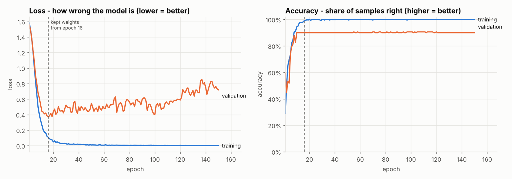
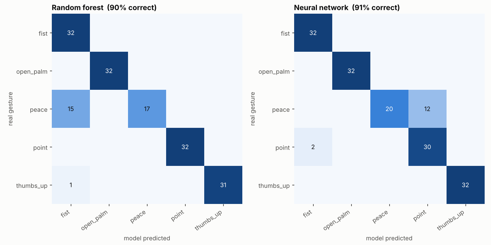

# Learn machine learning with Gesture Studio

This guide explains the ideas behind machine learning using this project as the example.
You don't need any maths or coding background. Every term is tied to something you can see
in the app or in the training output.

**Contents**

1. [The big idea](#1-the-big-idea)
2. [Dataset and samples](#2-dataset-and-samples)
3. [Features](#3-features)
4. [Why landmarks beat raw images here](#4-why-landmarks-beat-raw-images-here)
5. [Labels](#5-labels)
6. [Normalisation](#6-normalisation)
7. [Train / validation / test split](#7-train--validation--test-split)
8. [The model](#8-the-model)
9. [Weights](#9-weights)
10. [Loss](#10-loss)
11. [Epochs, batches and learning rate](#11-epochs-batches-and-learning-rate)
12. [Overfitting](#12-overfitting)
13. [Accuracy](#13-accuracy)
14. [The confusion matrix](#14-the-confusion-matrix)
15. [Inference](#15-inference)
16. [Motions: learning from sequences](#16-motions-learning-from-sequences)
17. [How to collect good data (checklist)](#how-to-collect-good-data-checklist)
18. [Glossary](#glossary)

---

## 1. The big idea

Normal programming: **you write the rules**.

> *If the index finger is up and the others are down, it's "point".*

That gets hard fast. What counts as "up"? What if the hand is tilted, far away, or it's a left hand?

Machine learning flips it around: **you give examples, the computer finds the rules**.

> *Here are 150 pictures of "point", 150 of "peace", 150 of "fist". Work out what makes them different.*

In Gesture Studio:

| You do this… | …which in ML terms is |
|---|---|
| Record yourself making gestures on the Collect page | building a **dataset** |
| Each recorded moment of your hand | a **sample** |
| The numbers describing the hand | the **features** |
| The gesture name you recorded it as | the **label** |
| Run `train.py` | **training** a **model** |
| Use it on the Live page | **inference** |

The rest of this guide goes through each of these.

---

## 2. Dataset and samples

A **dataset** is a collection of examples. Each example is a **sample**.

On the Collect page, holding *record* on a pose captures 10 samples per second. Five seconds of
"peace" gives you about 50 samples of peace. The exported CSV is the dataset: open it in Excel and
each **row is one sample**.

```
label, take, x0, y0, z0, x1, y1, z1, …, x20, y20, z20
peace, 4,    0,  0,  0,  0.31,-0.20,-0.17, …
```

The included `training/sample_data/sample_poses.csv` has **800 samples** of 5 gestures (160 each).

**How much data do you need?** For hand poses with landmarks, roughly 100–200 samples per gesture
works well. That is only 10–20 seconds of recording each. *Variety* matters more than quantity
(see the [checklist](#how-to-collect-good-data-checklist)).

---

## 3. Features

A model can't look at a hand. It can only do arithmetic on numbers.
**Features** are the numbers we give it to describe each sample.

[MediaPipe Hands](https://ai.google.dev/edge/mediapipe/solutions/vision/hand_landmarker) (the
library drawing the skeleton on the camera) finds **21 landmarks** on your hand: the wrist plus
4 points along each finger.

```
            8   12  16  20          0  = wrist
            |   |   |   |           4  = thumb tip
            7   11  15  19          8  = index fingertip
            |   |   |   |           12 = middle fingertip
      4     6   10  14  18          16 = ring fingertip
       \    |   |   |   |           20 = pinky fingertip
        3   5---9---13--17
         \   \          /
          2   \        /
           \   \      /
            1---0----
```

Each landmark has an **x** (left–right), **y** (up–down) and **z** (depth) value.
21 points × 3 = **63 numbers**. Those 63 numbers are the features of one pose sample.

In the CSV, `x8, y8, z8` is the index fingertip. For a "point", `y8` is a large negative number
(far above the wrist). For a "fist", it's close to 0. The model's job is to discover patterns
like that by itself.

---

## 4. Why landmarks beat raw images here

You could also feed the model the **raw camera image**. That is how general image recognition works.
For this project, landmarks are a much better choice:

| | Raw images | Landmarks (what we use) |
|---|---|---|
| Numbers per sample | 640 × 480 × 3 colours = **921,600** | **63** |
| What the model must learn | Where the hand is, what a hand looks like, ignoring the background, lighting, skin tone, sleeves… *and then* the gesture | Only the gesture. MediaPipe already found the hand. |
| Data needed | Thousands of images per gesture | ~100 samples per gesture |
| Training time | Minutes to hours, often needs a GPU | Seconds on any laptop |
| Model size | Megabytes | Kilobytes (the sample model's weights are 25 KB) |
| Robust to a new room / lighting / outfit | Only if you recorded in many rooms | Mostly yes: the background never reaches the model |
| Privacy | You store photos of people | You store 63 numbers, no images |

MediaPipe is itself a neural network, trained by Google on a huge number of hand images.
We stand on its shoulders: it turns pixels into a clean skeleton, and our small model only has
to learn *your* gestures from that skeleton. Using one model's output as another model's input
like this is a very common and powerful trick.

The trade-off: anything MediaPipe doesn't capture is invisible to us. We can't tell a painted
nail from a plain one, or what you're holding. For hand gestures that doesn't matter.

---

## 5. Labels

The **label** is the answer for each sample: the gesture name (`peace`, `fist`…).
When you select "peace" and hold record, every sample gets the label `peace`.

Learning from examples that come with the right answers is called **supervised learning**.
The model sees the features, guesses a label, compares its guess with the real label, and adjusts.

The set of possible labels are the **classes**. Picking one of a fixed set of classes is
called **classification**.

**Wrong labels poison the dataset.** If you were still lowering your hand while "peace" was recording,
those samples teach the model that a half-lowered hand is "peace". That's why the Collect page lets
you delete bad samples and takes.

### The "none" class

A classifier *always* picks one of its classes. It has no built-in way to say "that's nothing".
If your only classes are fist, peace and point, then scratching your nose will be classified as
one of them. Adding a `none` class (relaxed hands, random positions, half-gestures) gives
the model somewhere to put "not a gesture". Gesture Studio never triggers actions for classes
named `none`, `idle`, `nothing`, `background`, `rest` or `neutral`.

---

## 6. Normalisation

Look at the raw MediaPipe values: x and y are positions *in the image* (0 = left/top edge, 1 = right/bottom edge).
A "peace" sign in the top-left corner and one in the bottom-right would have completely different numbers.
A hand close to the camera has bigger distances between points than a hand far away.

We don't want the model to learn "peace is in the top-left". We want "peace is two fingers up".
So before anything else, every sample is **normalised** (`web/src/lib/features.js`):

1. **Move the wrist to (0, 0, 0).** Subtract the wrist position from every point.
   Now position in the frame doesn't matter.
2. **Divide by hand size.** We measure the distance from the wrist (0) to the base of the middle finger (9)
   and divide everything by it. Now distance from the camera doesn't matter.
3. **Mirror left hands.** A left-hand peace is the mirror image of a right-hand peace. Flipping x for
   left hands means both look the same to the model, so you can use either hand.
4. **Fix the aspect ratio.** x is converted to the same units as y first, otherwise a widescreen
   camera would squash the hand sideways.

```
before: wrist at (0.62, 0.71), index tip at (0.66, 0.38)   ← depends on where/how far your hand is
after:  wrist at (0, 0),       index tip at (0.18, -1.95)  ← only depends on the hand's shape
```

Normalisation means the model doesn't have to learn these irrelevant variations from data,
so it needs far fewer samples.

**What we deliberately did *not* normalise:** rotation. "Point up" and "point sideways" stay different,
because you might want them to be different gestures. If you don't, record both under the same label.

**The golden rule:** the *exact* same normalisation must run during training and live use. That's why
`features.js` (browser) and `features.py` (Python) are mirror images, and `npm test` checks they agree to
6 decimal places.

---

## 7. Train / validation / test split

How do you know if a model is any good? You can't test it on samples it learned from. It might just
have memorised them, like a student who memorised last year's exam answers.

So `train.py` hides part of the data:

| Set | Share | Purpose | Analogy |
|---|---|---|---|
| **Training** | ~70% | The model learns from these | The textbook |
| **Validation** | ~15% | Checked after every epoch; used to pick the best moment to stop | Practice exams |
| **Test** | ~15% | Used **once**, at the end, to report the final score | The real exam |

With the sample data: 480 training, 160 validation and 160 test samples.

### Takes: keeping the test fair

When you hold record for 3 seconds you get 30 samples that are nearly identical, like 30 frames of the
same photo. If 25 of them went into training and 5 into the test set, the test would be easy:
the model has already seen almost exactly those samples.

So Gesture Studio records a **take** number with each sample (one take = one press of the record
button), and the split keeps **whole takes together**. That's why recording *several short takes*
gives you a more honest score than one long take. The training output tells you which split it used.

---

## 8. The model

A **model** is a function with adjustable settings: features go in, a guess comes out.
Gesture Studio trains two very different kinds and compares them.

### Model A: random forest

A **decision tree** is a flowchart of yes/no questions learned from the data. Something like:

```
is y8 (index tip height) below -1.4?
├── yes: is y12 (middle tip height) below -1.4?
│        ├── yes → peace
│        └── no  → point
└── no:  is x4 (thumb tip sideways) above 0.6?
         ├── yes → thumbs_up
         └── no  → fist
```

One tree makes mistakes, so a **random forest** trains 150 trees, each on a slightly different random
subset of the data and features, and lets them **vote**. If 120 of 150 trees say "peace", the confidence is 80%.

- ✅ Works well with little data, trains instantly, nothing to tune
- ✅ You can read it: open `exports/<name>/random_forest/forest.json`, it really is just questions and answers
- ❌ Its decision boundaries are "blocky", and the file grows with the data

### Model B: neural network

A small **neural network** (`training/gesture_studio/models.py`):

```
63 inputs ─► 64 "neurons" ─► 32 "neurons" ─► 5 outputs (one score per gesture) ─► softmax ─► probabilities
```

Each neuron computes a **weighted sum** of everything in the layer before it, then applies a simple
rule (ReLU: *if negative, use 0*). Stacking layers lets the network build up from simple patterns
("index finger is extended") to combinations ("index and middle extended, others curled = peace").
The final **softmax** turns the 5 scores into probabilities that add up to 100%.

- ✅ Smooth decision boundaries, tiny file (25 KB), fast in the browser
- ✅ Gets better with more data
- ❌ Needs more data than a forest, and can overfit (see below)

`train.py` keeps whichever scored better on the test set. With small datasets they're often neck and neck.

---

## 9. Weights

The adjustable settings inside a neural network are its **weights**: one number for every connection
between two neurons (plus one "bias" per neuron). Our pose network has
63×64 + 64×32 + 32×5 weights + biases = **6,341 numbers**.

Before training they're random, so the network's guesses are random. Training is *only* the process
of finding good values for those 6,341 numbers. Once trained, the weights **are** the model:
`weights.bin` in the export folder is literally those numbers, and `model.json` describes how they're wired.

(A random forest has no weights. Its learned "settings" are the questions and thresholds in each tree.)

---

## 10. Loss

To improve, the network needs to know *how wrong* it is, as a single number. That number is the **loss**.

We use **cross-entropy loss**: if the right answer is "peace" and the network gave peace a probability of…

| P(peace) | loss | meaning |
|---|---|---|
| 0.99 | 0.01 | confidently right: tiny loss |
| 0.60 | 0.51 | right-ish but unsure |
| 0.20 | 1.61 | mostly wrong |
| 0.01 | 4.61 | confidently wrong: big loss |

So loss rewards being right *and* confident, and punishes being confidently wrong hardest.
With 5 gestures, random guessing scores about 1.6, which is exactly where the sample run starts
(`epoch 1 … loss 1.58`).

**Training = making the loss smaller.** For every batch of samples, PyTorch works out which way to nudge
each weight to reduce the loss a little (*backpropagation*), and the optimiser (Adam) takes that step.

---

## 11. Epochs, batches and learning rate

- **Batch**: the network learns from 32 samples at a time, then updates its weights.
- **Epoch**: one full pass through *all* the training samples. 480 samples / 32 = 15 updates per epoch.
- **Learning rate** (`--lr`, default 0.001): how big each nudge is. Too big and the network overshoots and
  bounces around; too small and it learns very slowly.

`train.py` trains for 150 epochs by default and prints progress:

```
epoch    1/150  loss 1.581 (val 1.559)  accuracy  29.2% (val  59.4%)
epoch   15/150  loss 0.122 (val 0.386)  accuracy  98.1% (val  90.0%)
```

and draws it in `training_curves.png`:



Read it like this:

- **Left (loss):** the blue *training* line falls quickly, so the network is learning. The orange
  *validation* line tells you if that learning carries over to samples it hasn't seen.
- **Right (accuracy):** the share of samples it gets right, on each set.
- **Dashed line:** the epoch with the lowest validation loss. Those weights are the ones kept.

---

## 12. Overfitting

Look at the chart above again. After epoch ~16, the training loss keeps falling to almost 0, but the
validation loss starts **rising**. The network is getting better at the training samples and *worse* at new ones.

That's **overfitting**: the model memorises the training examples (including their noise and
quirks) instead of learning the general pattern. It's like a student who memorises the textbook
word for word and then fails a question phrased differently.

How Gesture Studio deals with it:

- **Validation-based checkpointing:** we keep the weights from the best validation epoch, not the last one.
- **Dropout:** during training, 20% of neurons are randomly switched off at each step, so the network can't rely on any single one.
- **Weight decay:** a small penalty for very large weights, which keeps the model simpler.
- **The training script tells you** when it sees it: *"OVERFITTING: after epoch 16 the training loss kept falling but the validation loss went back up."*

What **you** can do, most effective first:

1. **More varied data**: different angles, distances, both hands, other people, other rooms.
2. Fewer epochs (`--epochs 50`).
3. Fewer, simpler gestures, or gestures that are more clearly different.

The opposite problem, **underfitting**, is when even the training accuracy stays low: the model is too
simple or the gestures are genuinely indistinguishable from the features. For hand poses that's rare.

---

## 13. Accuracy

**Accuracy** = correct predictions ÷ all predictions, on the **test set**.

The sample data gives:

```
Random forest:  90%   |   Neural network: 91%
```

What the numbers mean in practice:

- **97%+**: excellent
- **90–97%**: good, and smoothing on the Live page irons out the occasional wrong frame
- **75–90%**: usable with a high threshold, but expect mistakes
- **below 75%**: fix the data before anything else

Accuracy can be misleading:

- **Small test sets:** with 30 test samples, one mistake moves accuracy by 3%.
- **Unbalanced classes:** if 90% of your samples are "none", a model that always says "none" scores 90% and is useless.
  That's why the Collect page and `train.py` warn about imbalance.
- **It hides *which* mistakes happen.** For that you need the confusion matrix.

The script also reports per gesture:

- **Recall**: *"'peace' is only recognised 62% of the time"*. Of all real peace signs, how many were caught?
- **Precision**: *"When the model says 'point' it is right only 71% of the time"*. When it claims "point", how often is that true?

---

## 14. The confusion matrix

A grid with the **real gesture as rows** and the **predicted gesture as columns**.
The diagonal is correct answers. Everything off the diagonal is a mix-up.



In the neural network (right), read the `peace` row: 20 were correctly predicted as peace, but
**12 were predicted as point**. That's a **peace/point confusion**, and the script says so:

> *Your model confuses 'peace' and 'point' (12 'peace' seen as 'point'). Collect more varied samples of both,
> different angles, distances and both hands, and make the difference between them clear while recording.*

Why would that happen? A peace sign seen from the side hides one finger behind the other and looks like
a point. The sample data contains hands at steep angles and some sloppy takes, and the mistakes cluster in
a single test take: the model handles most peace signs, but not that particular one.

Typical fixes:

- Record both gestures **from the angles where they get confused**, so the model learns what tells them apart.
- Exaggerate the difference while recording (fingers clearly spread for peace).
- If two gestures are always confused, maybe they're too similar for your purpose. Pick more distinct gestures.

The random forest (left) makes a different mistake (peace → fist). Different models fail differently,
which is one reason comparing two is useful.

---

## 15. Inference

**Inference** means using the trained model on new data. On the Live page, every camera frame:

```
camera → MediaPipe (21 landmarks) → normalise (63 features) → model → probabilities → smoothing → threshold → event
```

The model outputs a **probability per gesture**, e.g. peace 0.86, point 0.10, fist 0.02…
These are the confidence bars. But raw predictions flicker: one frame says peace, the next says point
because a finger moved slightly. Three controls turn this into reliable events:

- **Smoothing** averages each new prediction with the previous ones (an *exponential moving average*). One odd frame barely moves the bar.
- **Confidence threshold:** the top gesture must be above, say, 80% to count. When you're between gestures, nothing is confident enough, so nothing triggers.
- **Hold time / cooldown:** a pose must stay on top for a moment before it triggers, and triggers can't repeat too quickly.

The training report helps you choose the threshold:
*"Average confidence: 91% when right, 54% when wrong."* A threshold between those (e.g. 80%) keeps
most correct predictions and drops most wrong ones.

Inference is fast. The pose network does about 6,000 multiplications per frame, which takes well under a
millisecond in the browser. MediaPipe's hand tracking is the expensive part.

---

## 16. Motions: learning from sequences

A swipe isn't a hand *shape*, it's a *movement*. A single frame of a swipe looks just like an open palm.
So for **motion** gestures, a sample is a short **sequence of frames**:

1. While you hold record, every frame's landmarks are captured (about 30 per second).
2. For each frame we compute the 63 hand-shape numbers **plus 3 motion numbers**:
   - `dx`, `dy`: how far the wrist has moved since the first frame, measured in hand-sizes
     (so a swipe close to the camera and one far away look the same), with x flipped so that
     *moving to your right* is positive
   - `ds`: how much bigger or smaller the hand got (moving towards or away from the camera)
3. Every recording is **resampled to exactly 16 frames**. A slow swipe and a fast swipe both become 16 evenly
   spaced steps, because the model needs the same number of features every time.
4. The 16 × 66 = **1,056 numbers** are the features of one motion sample.

On the Live page, the motion model looks at a **sliding window**: the last ~0.8 seconds of movement
(the typical length of your recorded swipes), resampled to 16 frames, predicted on every frame.
When a swipe is recognised it fires once, then the window is cleared so the same swipe doesn't fire twice.

This "flatten the sequence into one long feature list" approach is simple and works well for short gestures.
For longer or more complex movements, models designed for sequences (1D convolutions, LSTMs, transformers)
do better. That's a natural next step once this makes sense.

**For motions, record a rest class** (`idle`: hand still or moving randomly). It's even more important than for poses,
because your hand is *always* moving a little.

---

## How to collect good data (checklist)

The model can only be as good as the examples it learns from. These matter far more than which model you pick.

**Before recording**
- [ ] Good, even lighting. Avoid a bright window behind you.
- [ ] Your whole hand is in frame and the skeleton follows it steadily.
- [ ] Choose gestures that look clearly different *from the camera's point of view*.
- [ ] Add a **`none`** pose (relaxed hand, half-gestures, scratching, waving) and an **`idle`** motion.

**While recording**
- [ ] Record each gesture in **at least 3–5 short takes** (3–5 seconds each) rather than one long one.
- [ ] Between takes, change **distance** (near/far), **position** (left/right/top/bottom of the frame) and **angle** (tilt, rotate a little).
- [ ] Use **both hands** if you'll use both live. Use one hand if only that one will be used.
- [ ] Move slightly *during* a pose take as well. 30 identical frames teach less than 30 slightly different ones.
- [ ] Only press record once the gesture is formed, and release before you relax.
- [ ] For motions: one press = one swipe. Vary speed (slow, normal, fast) and size, and record 30+ per motion.
- [ ] If possible, include **other people's hands**, other rooms and other times of day.

**After recording**
- [ ] Every gesture has a similar number of samples (within ~1.5×). The app warns you.
- [ ] Aim for 100+ samples per pose and 30+ per motion.
- [ ] Scroll through the thumbnails and delete takes where the skeleton glitched or you were mid-transition.
- [ ] Train, then **read the confusion matrix**. Record more of whatever gets confused, especially from the angle it fails at.
- [ ] Test live in the place you'll actually use it. If it fails there, record some samples there too.

---

## Glossary

| Term | In one line | In Gesture Studio |
|---|---|---|
| **Dataset** | All your examples | The exported CSV |
| **Sample** | One example | One row: one moment (pose) or one movement (motion) |
| **Feature** | A number describing a sample | The 63 normalised landmark coordinates (1,056 for motions) |
| **Label / class** | The right answer / the possible answers | `peace`, `fist`, `swipe_left`… |
| **Normalisation** | Removing irrelevant differences from the features | Wrist to origin, divide by hand size, mirror left hands |
| **Training set** | Examples the model learns from | ~70% of takes |
| **Validation set** | Examples checked during training | ~15%, picks the best epoch |
| **Test set** | Examples for the final, honest score | ~15%, used once |
| **Model** | A function that turns features into a prediction | Random forest or neural network |
| **Weights** | The numbers a neural network learns | `weights.bin` |
| **Loss** | How wrong the model is, as one number | Cross-entropy, printed each epoch |
| **Epoch** | One pass over all training data | `--epochs 150` |
| **Learning rate** | Size of each weight update | `--lr 0.001` |
| **Overfitting** | Memorising instead of generalising | Validation loss rises while training loss falls |
| **Accuracy** | Share of correct predictions | Printed per model, on the test set |
| **Precision / recall** | How trustworthy / how complete the predictions for one class are | The "only recognised X% of the time" lines |
| **Confusion matrix** | Real vs predicted, for every pair of classes | `confusion_matrices.png` |
| **Inference** | Using a trained model on new data | The Live and Demo pages |
| **Softmax** | Turns scores into probabilities that sum to 1 | Last layer of the network |
| **ONNX** | A standard file format for models, used by many tools | `model.onnx` (Unreal NNE, TouchDesigner, Unity…) |
| **TensorFlow.js** | Runs models in the browser | `model.json` + `weights.bin` |

### Things to try next

1. Train on the sample data with `--epochs 20` and `--epochs 500`. How do the curves change?
2. Record a dataset, train, then delete half the samples of one gesture and train again. What happens to the confusion matrix?
3. Record gestures with only your right hand, then test with your left. Then turn off left-hand mirroring in `features.js` and `features.py` (both!) and compare.
4. Raise the threshold on the Live page until random movements stop triggering. How much slower does it feel?
5. Change the hidden layer sizes in `models.py` (e.g. `(16,)` or `(256, 128)`). Bigger isn't always better.
