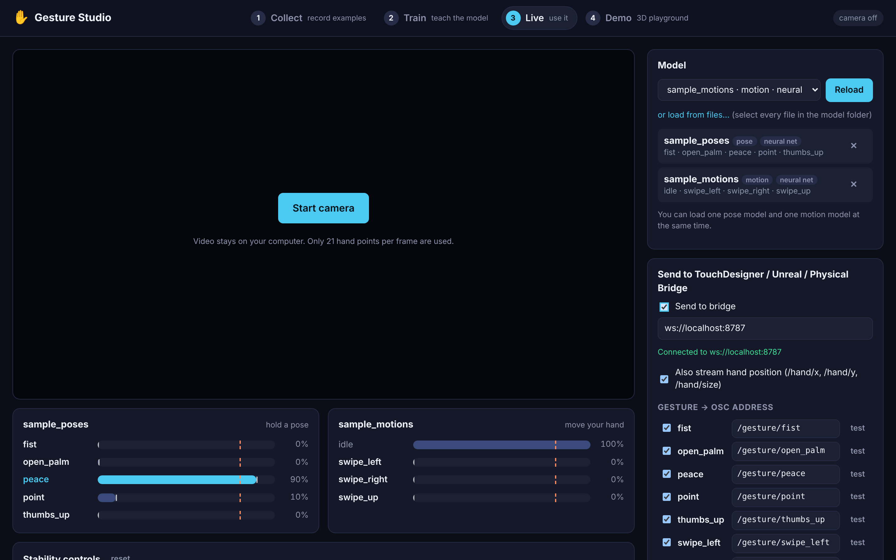
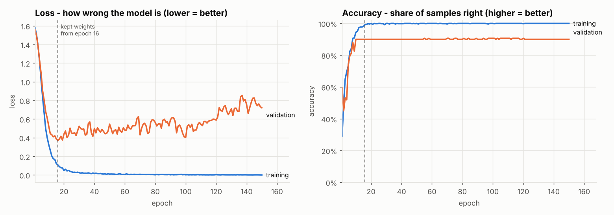
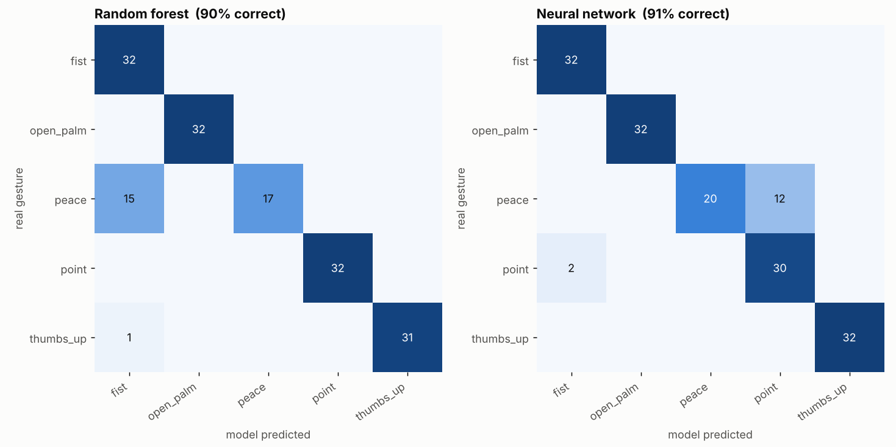

# ✋ Gesture Studio

Teach your computer your own hand gestures, then use them to control creative software:
TouchDesigner, Unreal, a Physical Bridge setup, or the included Three.js playground.

It's built for designers who are new to machine learning. Every step explains itself, and
[**LEARN.md**](LEARN.md) uses this project to teach the basic ideas behind machine learning.



```
 1 COLLECT (browser)        2 TRAIN (Python)              3 LIVE (browser)                 OUTPUTS
 ┌───────────────────┐     ┌──────────────────────┐     ┌──────────────────────┐        ┌───────────────┐
 │ webcam → MediaPipe│ CSV │ random forest  ┐     │model│ webcam → features →  │ JSON   │ bridge        │──OSC──► TouchDesigner
 │ 21 hand points    │────►│ neural network ┴ best├────►│ model → smoothing →  ├───────►│ (npm run      │──OSC──► Unreal
 │ → normalised      │     │ charts + advice      │     │ threshold → events   │  WS    │  bridge)      │──WS───► Physical Bridge, …
 └───────────────────┘     └──────────────────────┘     └──────────┬───────────┘        └───────────────┘
                                                                    └────────► 4 DEMO: Three.js scene
```

| Part | What it does | Where |
|---|---|---|
| **1 · Collect** | Webcam + hand skeleton. Create gestures, hold *record*, review/delete samples, balance warnings, export CSV | `web/` (Vite + React) |
| **2 · Train** | Trains a random forest and a small neural network, compares them, plots loss/accuracy and confusion matrices, explains the results in plain English, exports ONNX + TensorFlow.js | `training/train.py` and `training/gesture_studio_training.ipynb` (Jupyter / Colab) |
| **3 · Live** | Runs your model on the webcam with confidence bars, smoothing and a threshold; sends gestures over OSC and WebSocket | `web/` + `web/bridge/` |
| **4 · Demo** | Gestures change colour, rotate, and fire particle bursts in a Three.js scene | `web/` |
| Examples | TouchDesigner and Unreal step-by-step setups | `examples/` |
| Sample data | Small synthetic pose and swipe datasets, so you can test training straight away | `training/sample_data/` |

---

## Setup on Windows

You need to do this once. It takes about 15 minutes, mostly downloads.

### 1. Install the tools

1. **Node.js (LTS version)** from <https://nodejs.org>. Click through the installer with the default options.
2. **Python 3.12** from <https://www.python.org/downloads/>.
   **Important:** on the first installer screen, tick **"Add python.exe to PATH"**.
3. *(optional)* **Git** from <https://git-scm.com> and **VS Code** from <https://code.visualstudio.com>.

Check everything worked: open **PowerShell** (Start menu → type *PowerShell*) and run:

```powershell
node --version     # should print v20 or newer
py --version       # should print Python 3.12.x
```

### 2. Get the project

Either download the ZIP from GitHub (green **Code** button → *Download ZIP*) and unzip it, or:

```powershell
git clone https://github.com/devsaraf20/gesture-studio.git
```

In the commands below, `C:\path\to\gesture-studio` is wherever you put the folder.
*Tip:* in File Explorer, open the folder, click the address bar, type `powershell` and press Enter.
A PowerShell window opens already in that folder.

### 3. Set up the web app

```powershell
cd C:\path\to\gesture-studio\web
npm install
npm start
```

`npm start` starts two things: the web app (it opens <http://localhost:5173> in your browser) and
the **bridge** that forwards gestures to other software. Keep this window open while you work;
press `Ctrl + C` to stop it.

> Windows Firewall may ask if Node.js can use the network: click **Allow** (private networks).
> Use **Chrome or Edge**. Allow camera access when the browser asks.

### 4. Set up Python (for training)

Open a **second** PowerShell window:

```powershell
cd C:\path\to\gesture-studio\training
py -3.12 -m venv .venv
.venv\Scripts\Activate.ps1
pip install torch --index-url https://download.pytorch.org/whl/cpu
pip install -r requirements.txt
```

- `venv` creates a private Python just for this project, so nothing clashes with other software.
- If `Activate.ps1` says *running scripts is disabled*, run this once and try again:
  `Set-ExecutionPolicy -Scope CurrentUser RemoteSigned`
- The first `pip install` line gets the smaller CPU-only PyTorch. You don't need a graphics card: these models train in seconds.
- Every time you open a new PowerShell for training, run `.venv\Scripts\Activate.ps1` again. You'll see `(.venv)` at the start of the line.

Test it on the included sample data:

```powershell
python train.py
```

You should see six steps, ending with *All done*. The charts and a written report are in
`training\exports\sample_poses\`.

---

## Using it

### 1 · Collect (browser, **Collect** tab)

1. Click **Start camera**. You should see your hand with a coloured skeleton.
2. Gestures come in two types:
   - **Pose**: a still hand shape (fist, peace, point). Holding *record* captures **10 samples per second**.
   - **Motion**: a movement (swipe left/right/up). **One press = one sample**: press, do the whole movement, release.
3. Click a gesture on the right to select it, then **hold the red button** (or hold **Space**) to record.
   **3·2·1 timed** gives you a countdown so both hands are free.
4. Record **several short takes** per gesture (e.g. 5 takes × 3 seconds) and change angle, distance and hand between takes.
5. Watch the counts and warnings. The app tells you when gestures are unbalanced or too small.
6. Review samples under the camera: hover a thumbnail and click ✕, or delete a whole take.
7. Click **Download poses CSV** (and/or **Download motions CSV**) and save it into the `training` folder.

Your samples are saved in the browser automatically. You can also import a CSV back in.
See the [data collection checklist](LEARN.md#how-to-collect-good-data-checklist).

### 2 · Train (Python)

```powershell
cd C:\path\to\gesture-studio\training
.venv\Scripts\Activate.ps1
python train.py gesture_poses.csv
```

The script:

1. loads and checks your data (balance, size, takes)
2. splits it into training / validation / test sets
3. trains a **random forest**
4. trains a small **neural network**, printing loss and accuracy per epoch
5. tests both on samples they've never seen, draws **confusion matrices** and explains them, e.g.
   *"Your model confuses 'peace' and 'point' (12 'peace' seen as 'point'). Collect more varied samples of both…"*
6. exports both models and copies the best one to `web/public/models/<name>/`

Results are in `training\exports\<name>\`: `training_curves.png`, `confusion_matrices.png`, `report.md`, and the model folders.

Useful options: `--epochs 300`, `--name my_gestures_v2`, `--show` (open the charts in windows), `--help`.

**Jupyter / Google Colab:** `training/gesture_studio_training.ipynb` does the same, one cell at a time, with explanations.
- On your laptop: `pip install jupyter` (included in requirements), then `jupyter notebook gesture_studio_training.ipynb`.
- In Colab: open <https://colab.research.google.com/github/devsaraf20/gesture-studio/blob/main/training/gesture_studio_training.ipynb>,
  set `USE_MY_OWN_DATA = True`, run all cells, upload your CSV, and download the zip at the end.
  (If the project isn't on the `main` branch yet, change `BRANCH` in the first cell.)

| Example output (sample data) | |
|---|---|
|  |  |

### 3 · Live (browser, **Live** tab)

1. Pick your model in the list (anything `train.py` produced) and click **Load**.
   From Colab: **load from files** and select every file in the unzipped `best` folder.
   You can load one pose model and one motion model at the same time.
2. Each gesture has a bar: the **filled bar** is the smoothed confidence, the **white tick** is this frame's raw
   confidence, the **dashed orange line** is your threshold. The triggered gesture lights up.
3. Tune the **stability controls**:
   - **Confidence threshold**: how sure the model must be. Raise it if random movements trigger gestures.
   - **Smoothing**: averages recent frames. Raise it if the bars flicker.
   - **Hold time**: how long a pose must stay on top before it counts.
   - **Cooldown**: minimum time between triggers (separate for motions, so one swipe fires once).
4. Gestures named `none`, `idle`, `nothing`, `background`, `rest` or `neutral` never trigger anything.
   They exist to give the model somewhere to put "no gesture".

### 4 · Demo (browser, **Demo** tab)

A Three.js scene. By default: **peace** changes colour, **point** spins while held, **fist** fires a particle burst,
**swipe left/right** rotate 90°, and the object leans towards your hand. Change the mapping on the right.
The buttons under *Try the actions* work without a camera.

---

## Sending gestures to TouchDesigner, Unreal and Physical Bridge

Browsers can't send OSC (UDP) themselves, so the Live page sends JSON over a WebSocket to the small
**bridge** program (`web/bridge/server.js`). It starts with `npm start`, or on its own with `npm run bridge`.
The bridge passes each message on:

| Output | Address | Use it in |
|---|---|---|
| OSC over UDP | `127.0.0.1:10000` | TouchDesigner (OSC In CHOP/DAT) |
| OSC over UDP | `127.0.0.1:8000` | Unreal (OSC plugin) |
| WebSocket, JSON | `ws://localhost:8787` | TouchDesigner WebSocket DAT, Node, p5.js, anything |
| WebSocket, Physical Bridge format | `ws://localhost:8787/physical` | Physical Bridge clients |

Ports and OSC targets are in `web/bridge/config.json`. On the Live page, tick **Send to bridge**,
choose the OSC address for each gesture, and use the **test** buttons. `npm run monitor` prints the OSC
messages arriving on port 10000, so you can check everything works without TouchDesigner.
Open <http://localhost:8787> to see the bridge status.

Step-by-step guides: [**TouchDesigner**](examples/touchdesigner/README.md) · [**Unreal Engine**](examples/unreal/README.md)

### Message formats

**OSC** (all numbers are 32-bit floats):

| Address | Arguments | When |
|---|---|---|
| `/gesture/<name>` (editable per gesture) | `1` on start, `0` on end | pose: held = 1; motion: short pulse |
| `/gesture/current` | `"<name>"`, confidence | on start; `"none"`, `0` on end |
| `/hand/x`, `/hand/y` | 0–1 (mirrored view: x = 0 is your left) | ~30/s, if *stream hand position* is on |
| `/hand/size` | hand size relative to frame height | ~30/s |
| `/hand/present` | `1` / `0` | ~30/s |

**WebSocket JSON** (`ws://localhost:8787`):

```json
{ "type": "gesture", "gesture": "peace", "state": "start", "value": 1, "confidence": 0.93, "mode": "pose", "time": 1730800000000 }
{ "type": "hand", "present": true, "x": 0.42, "y": 0.61, "size": 0.21 }
```

**Physical Bridge format** (`ws://localhost:8787/physical`):

```json
{ "pb": 1, "source": "gesture-studio", "kind": "trigger", "channel": "gesture/peace", "value": 1, "confidence": 0.93, "ts": 1730800000000 }
{ "pb": 1, "source": "gesture-studio", "kind": "vector",  "channel": "hand", "value": [0.42, 0.61, 0.21], "ts": 1730800000000 }
```

> **Note:** the `physical-bridge` repository doesn't define a message format yet, so the one above is a proposal.
> It is defined in a single function, `toPhysicalBridge()` in [`web/bridge/formats.js`](web/bridge/formats.js). Change it
> there to match your Physical Bridge. To push messages to a Physical Bridge server instead of having it connect,
> set `physicalBridge.forwardUrl` in `web/bridge/config.json` (e.g. `"ws://192.168.1.20:9000"`).

---

## Project structure

```
gesture-studio/
├── README.md                  ← you are here
├── LEARN.md                   ← machine learning explained with this project
├── web/                       ← parts 1, 3, 4 (Vite + React) and the bridge
│   ├── src/pages/             Collect, Train, Live, Demo pages
│   ├── src/lib/features.js    landmark normalisation (mirrors training/gesture_studio/features.py)
│   ├── src/lib/runtime.js     live engine: features → model → smoothing → events
│   ├── src/lib/smoother.js    smoothing, threshold, hold time, cooldown
│   ├── src/lib/models.js      loads TF.js and random forest models
│   ├── src/lib/demoScene.js   the Three.js playground
│   ├── bridge/                WebSocket → OSC / Physical Bridge relay (config.json, formats.js)
│   ├── public/models/         trained models the Live page can load (train.py copies here)
│   └── tests/                 npm test
├── training/                  ← part 2 (Python)
│   ├── train.py               the training script
│   ├── gesture_studio_training.ipynb   the same, as a notebook (Jupyter / Colab)
│   ├── gesture_studio/        features, data, models, explanations, plots, export
│   ├── sample_data/           sample_poses.csv, sample_motions.csv (synthetic)
│   ├── make_sample_data.py    regenerates the sample data
│   └── tests/                 python tests/test_pipeline.py
└── examples/
    ├── touchdesigner/         OSC In CHOP / DAT and WebSocket DAT recipes + callback scripts
    └── unreal/                Blueprint OSC receiver walkthrough
```

## About the sample data

`training/sample_data/` contains **synthetic** hands: a simple 3D stick-figure hand with bendable fingers,
randomly rotated, scaled, moved, mirrored and jittered, then put through exactly the same normalisation as the
web app (`make_sample_data.py`). It's there to test the pipeline and to show realistic training output
(including a peace/point mix-up). The sample models in `web/public/models/` were trained on it, so they work
in the Live page as a demo, but real hands look different. **Train on your own recordings for real projects.**

## Troubleshooting

| Problem | Fix |
|---|---|
| Camera doesn't start | Use Chrome/Edge at `http://localhost:5173` (not a `file://` path). Click the camera icon in the address bar and allow. Close other apps using the webcam (Zoom, Teams, OBS). |
| "Loading the hand tracking model…" forever | The first start downloads the MediaPipe model (~8 MB) from Google. Check your internet connection. Offline? Download `hand_landmarker.task` once from the URL in `web/src/lib/handTracker.js` and put it in `web/public/mediapipe/`. |
| Hand skeleton jittery / lost | More light, plain background, keep your whole hand in frame. |
| `npm` / `py` not recognised | Reinstall Node.js / Python and tick "Add to PATH", then open a *new* PowerShell window. |
| Live page says "Not connected" | The bridge isn't running: use `npm start` (or `npm run bridge` in another window). |
| TouchDesigner / Unreal receive nothing | Firewall: allow Node.js. Check ports in `web/bridge/config.json`. Only one program can listen on a port: close `npm run monitor`. |
| Model list on the Live page is empty | Run `train.py` from the `training` folder. It copies into `web/public/models/`. Or use *load from files*. |
| Gestures trigger randomly | Raise the threshold, add a `none` gesture, record more varied data. See LEARN.md. |
| Training says classes are confused | Do what it says: more varied samples of those two gestures, then retrain. |

## Tests

```powershell
cd web;      npm test                        # features match Python, smoothing, OSC, bridge end-to-end
cd training; python tests/test_pipeline.py   # load → split → train → evaluate → export, for poses and motions
```

## Privacy

Video never leaves your computer. MediaPipe runs in the browser, and only the 21 hand points per frame are used.
Datasets are stored in your browser (IndexedDB) until you export them.
